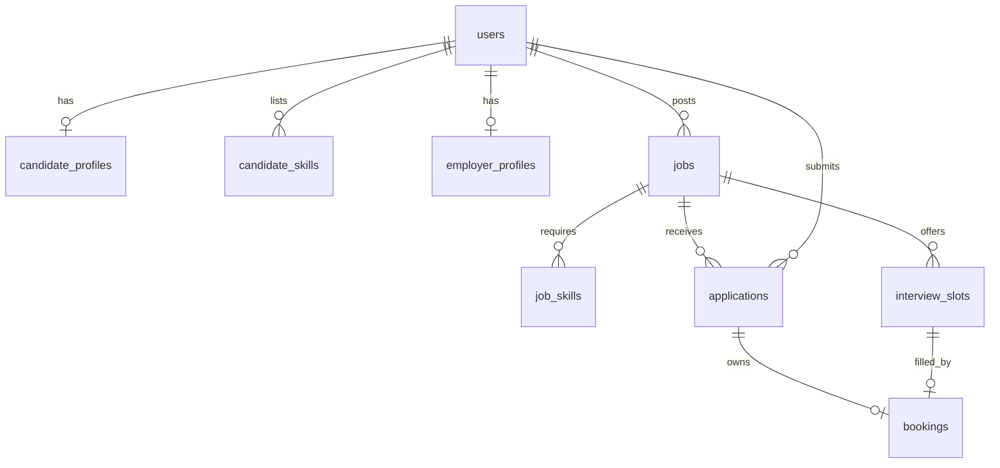

# SPEC — TalentBridge

This document is the living specification of the system that this repository
actually runs. It matches the code in the graded commit. Requirement IDs such as
`FP-AUTH-1` refer to the course `REQUIREMENTS.md`; the requirement-to-test map
lives in [`README.md`](README.md).

## 1. Product summary

TalentBridge is a locally runnable, browser-based recruiting marketplace with
two roles:

- **Candidate** — maintains a profile, skills, and a private plain-text resume;
  sees every open job ranked by a deterministic skill-overlap score; applies
  once per job; tracks status; books a 30-minute interview when an employer moves
  the application to `Interviewing`.
- **Employer** — maintains a company profile; creates, edits, and deletes own
  job postings; reviews applicants ranked by the same score; sets exactly one of
  four application statuses; publishes and deletes future 30-minute interview
  slots.

The matching baseline is deliberately simple and fully specified. An optional
LLM explanation (`FP-MATCH-2`) is **not implemented** and is marked `N/A` in the
README mapping table.

## 2. Architecture

| Layer | Choice | Notes |
|---|---|---|
| HTTP / UI | Flask 3.1.3, Jinja2 server-rendered HTML | No JavaScript framework, no build step, no network assets |
| Business logic | `app/services.py`, `app/matching.py` | Single implementation shared by both roles |
| Persistence | SQLite 3 (`app/schema.sql`) | Relational, file-backed, foreign keys ON, WAL journal |
| Auth | Flask signed-cookie session + scrypt password hashes | Session stores only `user_id`; role is re-read from the database |
| Tests | `unittest` + Flask test client | No third-party test service, isolated temporary database per test |
| Packaging | `Dockerfile` (python:3.13-slim) | Builds the complete environment from this repository |

Request flow:

```text
browser form/GET
  -> Flask route (app/auth.py, candidates.py, employers.py)
     -> login_required / ownership checks (app/security.py, services.py)
     -> service function (validation + SQL with bound parameters)
        -> SQLite (BEGIN IMMEDIATE for multi-row writes)
  -> Jinja template (autoescaped) or redirect / 401 / 403 / 404 / 409
```

There is no separate SPA build, no message broker, and no external service
required for grading. The only third-party Python package is Flask and its
transitive dependencies.

### Directory map

```text
app/
  __init__.py       application factory, error handlers, template filters
  config.py         environment-driven configuration
  constants.py      roles, statuses, slot length
  db.py             per-request SQLite connection + transaction helper
  schema.sql        migration 001 (idempotent DDL)
  security.py       scrypt hashing, session helpers, role/owner guards
  timeutil.py       UTC ISO-8601 parsing and formatting
  matching.py       normalization + required match score + sort keys
  services.py       all business operations and SQL
  auth.py           /register, /login, /logout
  candidates.py     candidate dashboard, profile, resume, applications, booking
  employers.py      company, jobs, applicants, availability
  seed.py           deterministic local demo data
  cli.py            init-db, seed, run commands
  templates/        Jinja templates (autoescape on)
  static/style.css  single local stylesheet
run.py              development server entry point
Dockerfile          complete runnable image
tests/              standard-library unittest suite
```

## 3. Data model and relationships

All timestamps are ISO-8601 UTC strings ending in `Z`. Primary keys are
autoincrement integers. Foreign keys are enforced (`PRAGMA foreign_keys = ON`)
and dependent rows cascade where deletion is allowed at all.

| Table | Key columns and constraints | Relationship |
|---|---|---|
| `users` | `id` PK; `email` UNIQUE COLLATE NOCASE; `password_hash`; `role` CHECK in (`Candidate`,`Employer`); non-empty `display_name` | one account row per person, exactly one role |
| `candidate_profiles` | `user_id` PK/FK → users; `resume_text` | 1:1 with a Candidate user |
| `candidate_skills` | PK (`user_id`,`skill`); FK → users | many normalized skills per candidate |
| `employer_profiles` | `user_id` PK/FK → users; `company_name`; `description` | 1:1 with an Employer user |
| `jobs` | `id` PK; `employer_id` FK → users; non-empty `title`,`description`; timestamps | employer has many jobs |
| `job_skills` | PK (`job_id`,`skill`); FK → jobs ON DELETE CASCADE | many required skills per job; list may be empty |
| `applications` | `id` PK; `job_id`; `candidate_id`; `status` CHECK; `UNIQUE(job_id,candidate_id)` | candidate applies once to a job; job has many applications |
| `interview_slots` | `id` PK; `job_id`; `employer_id`; `start_at`; `end_at`; duration validated to 30 minutes | employer publishes slots for a job |
| `bookings` | `id` PK; `application_id` UNIQUE FK; `slot_id` UNIQUE FK | at most one booking per application and per slot |

Relationships in text form:



Deletion rules:

- A job is deletable only when it has **no applications and no interview
  slots**. Otherwise the API returns `409 Conflict` and changes nothing.
- Deleting an employee/user is not exposed in the UI; the schema cascades
  profiles, skills, jobs, applications, and bookings if it ever happens.
- Bookings are never deleted when an application leaves `Interviewing`; the
  slot therefore remains unavailable (FP-SCHED-2).

Skills are stored normalized (`trim`, lower-case, empty removed, duplicates
removed) in `candidate_skills` and `job_skills`, so matching never depends on
display formatting. The raw resume is stored separately and is never an input
to the score.

## 4. Authentication and authorization

### Accounts and credentials

- Registration accepts exactly two roles: `Candidate` and `Employer`. Any other
  role is rejected with `400`.
- Email is trimmed, lower-cased, and unique case-insensitively at the database
  level (`COLLATE NOCASE` + `UNIQUE`).
- Passwords must be at least 8 characters. They are hashed with Werkzeug's
  `scrypt` implementation (`generate_password_hash(..., method="scrypt")`),
  which uses a random salt and is a memory-hard password hash designed for this
  purpose. Plain text, reversible encryption, and fast general-purpose hashes
  are not used.
- `password_hash` is never selected into a template, JSON response, or log
  message. Only `id`, `email`, `role`, and `display_name` are exposed.

### Sessions

- Login stores only `session["user_id"]` in Flask's signed cookie. The cookie is
  `HttpOnly`, `SameSite=Lax`, and non-permanent sessions last 8 hours.
- `current_user()` re-reads the user row on every request, so a modified cookie
  cannot upgrade a Candidate into an Employer; changing the role in the database
  takes effect on the next request.
- Login calls `session.clear()` before setting the user id (session-fixation
  hygiene). Logout clears the session.
- `next` redirect targets are restricted to local paths that start with a single
  `/`, preventing open redirects.

### Server-side authorization contract

A decorator (`login_required(role)`) and explicit ownership checks in the
service layer enforce every protected operation. Hiding a button is never the
control.

| Situation | Observable response |
|---|---|
| No session, browser GET | `302` redirect to `/login?next=...` |
| No session, POST or non-GET | `401 Unauthorized` |
| Signed in with the wrong role | `403 Forbidden` |
| Signed in, object does not exist at all | `404 Not Found` |
| Signed in, object exists but belongs to another user | `403 Forbidden` |
| Duplicate application / dependent job / booked slot | `409 Conflict` |
| Invalid form value | `400 Bad Request` |

Ownership rules:

- Candidates can read and replace only their own resume; another candidate or
  any employer receives `403` (FP-CAN-1, FP-SEC-1).
- Employers can edit/delete only their own jobs and can see applicants only for
  their own jobs; another employer receives `403`.
- A candidate can book only with their own application; another candidate's
  application receives `403`.
- A candidate has no route that changes application status; posting to the
  employer status route returns `403`.

## 5. Routes and server actions

Legend: **Auth** is public, any signed-in user, Candidate, or Employer.

| Method | Path | Auth | Purpose | Main errors |
|---|---|---|---|---|
| GET | `/` | public | Landing page or role dashboard redirect | — |
| GET | `/healthz` | public | Container health JSON | — |
| GET/POST | `/register` | public | Create account and sign in | 400 invalid, 409 duplicate email |
| GET/POST | `/login` | public | Sign in | 401 bad credentials |
| POST | `/logout` | any | Clear session | 401 |
| GET | `/candidate/` | Candidate | Ranked job dashboard | 401/403 |
| GET/POST | `/candidate/profile` | Candidate | View/update display name, skills, resume | 400 |
| GET | `/candidate/resume/<candidate_id>` | Candidate owner | Read own resume | 403 |
| GET | `/candidate/jobs/<job_id>` | Candidate | Job detail, score, application state | 404 |
| POST | `/candidate/jobs/<job_id>/apply` | Candidate | Create `Pending` application | 404, 409 duplicate |
| GET | `/candidate/applications` | Candidate | Own applications, status, booking, available slots | 401/403 |
| POST | `/candidate/applications/<application_id>/book` | Candidate owner | Book a slot atomically | 403, 404, 409 |
| GET | `/employer/` | Employer | Own jobs and totals | 401/403 |
| GET/POST | `/employer/company` | Employer | View/update company profile | 400 |
| GET/POST | `/employer/jobs/new` | Employer | Create posting | 400 |
| GET/POST | `/employer/jobs/<job_id>/edit` | Employer owner | View/update posting | 403, 404, 400 |
| POST | `/employer/jobs/<job_id>/delete` | Employer owner | Delete posting | 403, 404, 409 |
| GET | `/employer/jobs/<job_id>/applicants` | Employer owner | Ranked applicant list | 403, 404 |
| POST | `/employer/applications/<application_id>/status` | Employer owner | Set one of four statuses | 403, 404, 400 |
| GET/POST | `/employer/jobs/<job_id>/slots` | Employer owner | List/create 30-minute slots | 403, 404, 400 |
| POST | `/employer/slots/<slot_id>/delete` | Employer owner | Delete unbooked slot | 403, 404, 409 |

## 6. UI screens

All screens use one local stylesheet; there are no external fonts, scripts, or
images, so the UI works offline.

1. **Landing** (`/`) — product summary and entry points; signed-in users are
   redirected to their dashboard.
2. **Login / Register** — role picker on registration; validation messages;
   demo-account note without rendering the demo password.
3. **Candidate dashboard** — every open role as a card: title, company,
   required-skill chips, description snippet, integer match score, and current
   application status. Sorted by score, then case-insensitive title, then job id.
4. **Candidate profile** — display name, comma-separated skills, plain-text
   resume, privacy explanation, and the scoring formula.
5. **Candidate resume page** — read-only escape-safe preview, owner only.
6. **Candidate job detail** — full description, score, required skills, and
   apply button or current status/booking.
7. **Candidate applications** — each application with job, company, status,
   applied time, booked interview, and an inline slot picker when the status is
   `Interviewing` and no booking exists.
8. **Employer dashboard** — totals plus a table of own jobs with applicant/slot
   counts and actions (applicants, availability, edit, delete).
9. **Company profile** — company name and public description.
10. **Job form** — create/edit title, description, and required skills.
11. **Applicant management** — ranked rows with identity, skills, score, status,
    booking, and a four-value status selector. Resumes are deliberately absent.
12. **Availability** — create future 30-minute slots in UTC, see booked/available
    state, delete only unbooked slots.
13. **Error page** — friendly message for 400/401/403/404/409 and other HTTP
    errors.

## 7. Matching contract (FP-MATCH-1)

Implementation: `app/matching.py`, used by
`services.list_recommended_jobs()` (candidate) and
`services.list_applicants()` (employer).

Normalization for both sides:

1. split on commas (form input) or accept an iterable;
2. trim surrounding whitespace;
3. convert to lower case;
4. remove empty values;
5. de-duplicate into a set.

Score, where `C` is the candidate skill set and `R` the required skill set:

```text
score = 100                                      when |R| = 0
score = floor(100 * |C intersection R| / |R|)   otherwise
```

The result is an integer from 0 to 100. Resume text is not an input. Both views
call the same function; neither re-implements the formula.

Ordering:

- Candidate dashboard: score descending, then `casefold(job.title)` ascending,
  then numeric job id ascending.
- Employer applicants: score descending, then
  `casefold(candidate.display_name)` ascending, then candidate id ascending.

Required examples (also in tests and seed data):

| Candidate skills | Required skills | Score |
|---|---|---:|
| Python, SQL | Python, SQL | 100 |
| Python | Python, SQL | 50 |
| Rust | Python, SQL | 0 |
| any | empty list | 100 |

The demo seed contains all four pairs: Alice/Backend (100), Bob/Backend (50),
Carol/Backend (0), and Alice/Junior Generalist (100, empty requirement).

## 8. Interview scheduling and booking transaction

### Slots

- An employer creates a slot for one of their jobs with a start and end
  datetime-local value. Values are interpreted and stored as UTC (`Z` suffix);
  every UI label says UTC, which is the documented unambiguous timezone.
- The start must be in the future, the end must be after the start, and the
  duration must be exactly 30 minutes. Other durations are `400`.
- Booked slots are excluded from the candidate query. An employer may not delete
  a booked slot (`409`).

### Booking eligibility (FP-SCHED-2)

`services.book_slot()` checks, in one transaction:

1. the application exists (`404`) and belongs to the signed-in candidate
   (`403`);
2. the application status is `Interviewing` (`409` otherwise);
3. the application has no existing booking (`409`);
4. the slot exists (`404`) and belongs to the employer of the application's job
   (`403`);
5. the slot start is in the future (`409`) and is not already booked (`409`);
6. then inserts one row in `bookings`.

Any failure rolls back the transaction, so neither the application nor the slot
is partially changed. The booking is visible on both the candidate applications
page and the employer applicant list.

If an application later leaves `Interviewing`, the booking row is retained; the
slot remains unavailable and still appears as booked to the employer.

### Atomicity (FP-SCHED-3)

```text
BEGIN IMMEDIATE                 -- database write lock acquired up front
  SELECT application + job employer
  validate owner, status, existing booking
  SELECT slot
  validate employer, future, existing booking
  INSERT INTO bookings (application_id, slot_id, created_at)
COMMIT
```

`BEGIN IMMEDIATE` serializes concurrent writers; `UNIQUE(bookings.slot_id)`
(and `UNIQUE(bookings.application_id)`) is the final database-level guarantee.
In a race, one transaction commits, the other's insert violates the constraint,
is rolled back, and is translated to HTTP `409` with the exact message
`Slot already booked`.

`tests/test_scheduling.py::ConcurrentBookingTests` synchronizes two threads with
a barrier and asserts exactly one success, one 409 with that message, and one
`bookings` row. A second test proves the uniqueness constraint exists in the
schema independently of the service code.

## 9. Security controls

| Control | Implementation |
|---|---|
| Password storage (FP-AUTH-2) | scrypt via Werkzeug, random salt, no reversible storage, hash never rendered |
| Server-side authorization (FP-AUTH-3) | role decorator + ownership queries in services; explicit 401/403/404 mapping |
| SQL injection (FP-SEC-2) | every user value is a bound `?` parameter; dynamic SQL only builds a placeholder list from internal integer ids; no string concatenation of input |
| XSS (FP-SEC-3) | Jinja autoescape for all HTML templates; no `\|safe`; all user text (profile, resume, company, job) is escaped |
| Secrets and test isolation (FP-SEC-4) | no real secrets in repo; `.env.example` placeholders; `.env` ignored; tests use a unique temporary SQLite database and no network |
| Session theft/fixation | HttpOnly + SameSite=Lax cookie, session cleared on login/logout, role read from DB |
| Open redirect | `next` restricted to local absolute paths |
| Large payloads | `MAX_CONTENT_LENGTH = 2 MiB` |
| Uploads | not supported, so no file-upload attack surface |

Known security limitation: this local demo does not implement per-form CSRF
tokens. The `SameSite=Lax` session cookie blocks cross-site POSTs, and the
grading environment is a local server; a production deployment should add
synchronizer tokens.

## 10. Error and validation contract

- **400** — missing/invalid title, description, company name, status, slot
  duration, past slot, end before start, bad email/password.
- **401** — no session on a non-GET request, bad login credentials, or a
  protected GET with `Accept: application/json` rather than a browser.
- **403** — wrong role, foreign resume, foreign job, foreign applicant list,
  foreign application booking, foreign slot.
- **404** — missing job, application, slot, or resume.
- **409** — duplicate application, duplicate registration email, job with
  applications/slots, booked slot deletion, booking when ineligible or already
  booked.
- **500** — unexpected error; no stack trace or secret is shown to the user.

## 11. Time, IDs, and demo conventions

- All timestamps are stored as `YYYY-MM-DDTHH:MM:SSZ` (UTC) and compared as
  strings, which is safe for this fixed format.
- IDs are stable autoincrement integers; seed resets them to make demos
  reproducible.
- Demo emails use the reserved `.test` TLD, and the shared password is explicitly
  a local/demo credential documented in README.md. No real personal data is
  included.

## 12. Out of scope

- `FP-MATCH-2` LLM explanation/recommendation: not implemented (`N/A`).
- PDF resume upload/extraction (optional in the course): not implemented.
- Email verification, password reset, OAuth, notifications: not implemented.
- CSRF tokens, rate limiting, pagination, and production WSGI server: documented
  limitations for this local grading build.
- SQLite is a relational database with a single writer; it is deliberately chosen
  so the whole system runs from one container without a separate database
  service. Booking correctness is enforced by a transaction plus a uniqueness
  constraint, not by an in-process lock.
